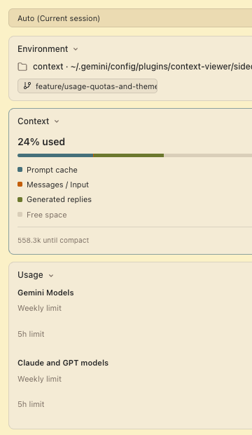

# Context & Environment Sidecar for Google Antigravity like in Claude Desktop

A lightweight, zero-token UI sidecar plugin for **Google Antigravity** that displays real-time context token usage, Git workspace / worktree status, and model quota limits right in the Auxiliary Pane.

 *(or view directly inside Antigravity)*

---

## Features

- **⚡ 0 Token Consumption**: Operates entirely as a local background sidecar (`server.py`), polling local transcripts and SQLite metadata without sending any prompts to LLMs.
- **📊 Real-time Context Breakdown**:
  - Live percentage and progress bar of the active 1M token context window.
  - Detailed token breakdown: **Prompt cache**, **User/Messages input**, and **Model generated replies**.
  - Remaining buffer calculation and one-click `/compact` button.
- **🔄 Git & Worktree Intelligence**:
  - Displays current project root and parent folder.
  - Detects active Git branch with one-click copy.
  - Automatically identifies whether the current session is running inside a Git Worktree.
- **📈 Model Usage Quotas (5h & Weekly Limits)**:
  - Circular SVG progress indicators for **Gemini Models** and **Claude & GPT models**.
  - Dynamic countdown timer showing exact reset times (`Resets in 6d 23h`, `Resets in 3h 20m`).
  - In-memory 8-second caching for zero system overhead.
- **🎯 Multi-Session Switcher**:
  - Automatically tracks and follows the currently open/focused conversation.
  - Allows manual switching between past sessions via dropdown.
  - One-click `Set Auto` button to restore automatic active-session tracking.
  - Clean `0 tokens` state for `+ New Conversation` draft views.
- **🎨 Native Gruvbox Material Theme**:
  - Styled to seamlessly match Google Antigravity's Gruvbox Material preset (Dark `#282828` and Light `#fbf1c7`).
  - Automatically adapts to system/IDE light & dark mode changes.
- **🔒 Local Security Hardened**:
  - Binds strictly to `127.0.0.1` (loopback only, unreachable from external networks).
  - Enforces HTTP `Host` header validation to block DNS-rebinding attacks.
  - Blocks cross-site browser requests (`Sec-Fetch-Site`).

---

## Requirements

- macOS (or Linux)
- Google Antigravity IDE / Antigravity 2.0
- Python 3 (standard pre-installed macOS Python 3, no `pip` packages required)

---

## Installation

### Method 1: Git Clone (Recommended)

Run this one-liner in your terminal:

```bash
git clone https://github.com/cardinalX/antigravity-context-viewer.git ~/.gemini/config/plugins/context-viewer
```

Then restart Google Antigravity or open a new conversation.

### Method 2: Manual / Offline Archive

1. Download or unpack `context-viewer` into:
   ```bash
   ~/.gemini/config/plugins/context-viewer/
   ```
2. Verify the folder structure:
   ```text
   ~/.gemini/config/plugins/context-viewer/
   ├── plugin.json
   ├── README.md
   └── sidecars/
       └── context/
           ├── sidecar.json
           └── server.py
   ```
3. In Google Antigravity, open the Auxiliary Pane on the right, click `+` (or `Extensions`), and select **Context & Environment**.

---

## License

MIT License.
